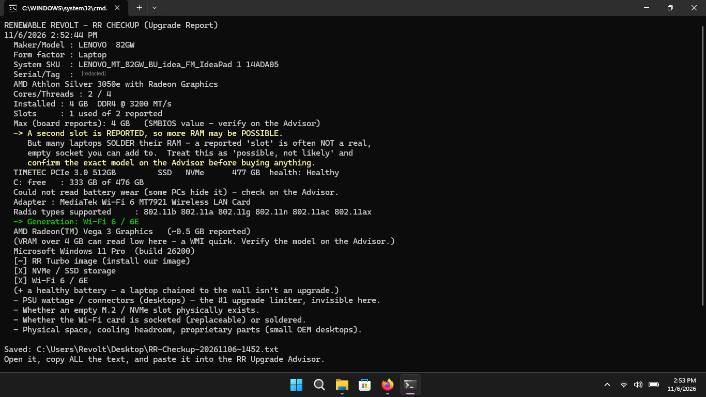

# RR Checkup

**A free, read-only PC upgrade report.**  Run it on a Windows laptop or desktop and it writes a plain-text "Upgrade Report" to your Desktop — what you have, and what's actually worth upgrading.

Made by [Renewable Revolt](https://renewablerevolt.org), a veteran-owned nonprofit that refurbishes e-waste PCs instead of landfilling them.  The goal of this tool is the same as the goal of the shop: keep working hardware in service.  Most "slow" computers don't need replacing — they need a $40 drive, a $20 Wi-Fi card, or a fresh battery.  RR Checkup tells you which.

## What it does

Reads what your machine knows about itself and reports:

- Exact make / model / serial — the key to looking up upgrade parts
- CPU, cores, threads
- RAM: installed, type (DDR3/4/5), slots used, and whether a RAM upgrade looks *possible*
- Storage: HDD vs SSD vs NVMe, health, and free space — flags the single biggest upgrade (getting off a spinning drive)
- Battery health (laptops): design vs. current capacity, as a percentage
- Wi-Fi generation (Wi-Fi 4 / 5 / 6 / 6E / 7)
- Graphics
- Windows build, UEFI / Secure Boot, TPM

Then it checks your machine against the three things that make a refurbished PC feel new: a solid-state drive, Wi-Fi 6, and (on laptops) a healthy battery.

## What it does NOT do

- It does **not** change anything.  It only reads, and writes one text file to your Desktop.
- It needs **no administrator rights** and makes **no network connection**.  No telemetry, no account — nothing leaves your computer.
- It **cannot** see a few things that decide an upgrade: your power supply's wattage (desktops), whether an empty M.2 slot physically exists, or whether the Wi-Fi card is socketed or soldered.  Those need a model lookup — which is what the **RR Upgrade Advisor** is for (below).

## How to run it

1. Download this repo (green **Code** button → **Download ZIP**) and unzip it.
2. Double-click **`RUN - RR Checkup.bat`**.
   Or, in PowerShell: `powershell -ExecutionPolicy Bypass -File .\RR-Checkup.ps1`
3. Wait about 20 seconds.  A report named `RR-Checkup-<date>.txt` lands on your Desktop.
4. Open it, copy all the text, and paste it into the **RR Upgrade Advisor** for an honest hold / upgrade / replace recommendation.

> Windows may warn about running a script it didn't sign.  The entire source is right here in [`RR-Checkup.ps1`](RR-Checkup.ps1) — read it before you run it.  That's the whole point of open source.

## The RR Upgrade Advisor

The report tells you what you *have*.  The Advisor tells you what to *do* about it.  It's a prompt you can paste into any capable AI chat — or host on your own website — that looks up your exact model, works out the parts software can't see, and gives a decisive **UPGRADE IT / HOLD WHAT YOU'VE GOT / REPLACE** answer.  It knows the OEM-desktop traps, too: a proprietary low-wattage power supply that can't feed a real graphics card is the classic money pit, and the Advisor will say so.

See [`docs/RR-Upgrade-Advisor-Prompt.md`](docs/RR-Upgrade-Advisor-Prompt.md).  It ships with two sample reports (a good upgrade-candidate laptop and a problematic small-form-factor desktop) so you can test it before you wire it up.

## Requirements

- Windows 10 or 11
- Windows PowerShell 5.1 (built into Windows) or newer

## License

[MIT](LICENSE).  Use it, fork it, ship it in your own shop.  No warranty — it's a read-only reporter, but you run it at your own risk.

## A note on honesty

This tool will never tell you to buy something.  Half the time the right answer is "install a free, tuned Windows image and a cheap SSD, and keep the machine three more years."  That's a feature, not a bug.  And when a machine genuinely can't do what you need, the Advisor is built to say that plainly rather than sell you an upgrade that won't help.
